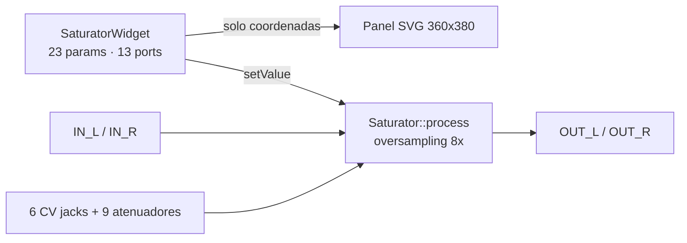

# Spec v2.8 — Panel Anthracite 24 HP (360 × 380 px)

| Campo | Valor |
|---|---|
| Módulo | **Anthracite** |
| Slug / marca | `Coal_Dynamics` / **Coal Dynamics** |
| Autor | Manuel Blanco |
| Licencia | MIT |
| Versión objetivo | `2.8.0` |
| Ámbito | Geometría del panel y posiciones de widgets (solo píxeles) |
| Fuera de alcance | DSP, IDs, enums, contrato de parámetros, oversampling, curvas, contexto |
| Ficheros que se modifican | `res/Saturator.svg`, `src/SaturatorWidget.cpp` |
| Ficheros que **no** se tocan | `src/Saturator.cpp`, `src/Saturator.hpp`, `src/dsp/*`, `src/utils/*`, `Makefile`, `plugin.json`, `res/*.svg` (salvo el panel) |
| Precondición externa | `plugin.json` → `"version": "2.8.0"` (lo aplica otro agente) |

> **Regla de oro del cambio:** solo se mueven píxeles. Ningún ID, enum, rango,
> default, curva ni línea de audio cambia. El diff de `src/Saturator.cpp` debe
> quedar vacío (existe un diff previo sin commitear de solo formato que **no**
> debe mezclarse con este cambio).

---

## 0. Cómo ejecutar este documento (para el agente local)

1. Lee §9 y §10 completos antes de editar.
2. Base exacta del SVG: `res/Saturator.svg`, **330 líneas**, LF, 125 375 bytes,
   `sha256 = 8e0b997ac0c44c7e74325454917b72f8c219af33a4d3d656477dbc972cff2288`.
3. Aplica los 45 recambios en el orden dado. En cada uno, el ancla (`oldString`)
   debe aparecer **exactamente** el número de veces indicado (1 salvo que la
   tabla diga ×2). Si el conteo no cuadra → **detente** y reporta; no improvises.
4. No reindentes, no reformatees ni reordenes nada fuera del texto sustituido.
5. Definition of done: `python specs/verify_v2.8_panel.py` devuelve
   `OK 167 comprobaciones, 0 fallos` y `git diff --stat` solo lista
   `res/Saturator.svg` y `src/SaturatorWidget.cpp`.

---

## 1. Resumen ejecutivo

Se ensancha el panel de **18 HP (270 × 380 px)** a **24 HP (360 × 380 px)** y se
reordena la UI en **tres bandas independientes** con centro en X = 60, 180 y 300
(paso 120 px). La altura no cambia: las filas de Y se conservan de v2.7 salvo las
cuatro excepciones justificadas (D4, D6, D11).

| # | Decisión | Justificación |
|---|---|---|
| D1 | `viewBox="0 0 360 380"`; fondo 360 × 380 | 24 HP × 15 px/HP = 360 px exactos |
| D2 | Centros de banda en 60 / 180 / 300 | Múltiplos de 7,5 px; simetría exacta respecto a 180 |
| D3 | Tres bloques verdes de 90 px: `15–105`, `135–225`, `255–345` | 30 px entre bandas; 15 px (1 HP) de margen exterior |
| D4 | Fila principal **única** `y = 127,4`: PAN = B−30, VOL = B, MAKEUP = B+30 | En v2.7 los VOL (y = 147,4) y MAKEUP (y = 155,0) se pisaban con su propia etiqueta; la fila única deja 3,6 px de aire bajo el knob |
| D5 | Filas de CV conservadas: jacks `y = 273`, atenuadores `y = 299,6` | Continuidad del patch: el ojo no reaprende la mitad inferior |
| D6 | Audio en `y = 352,6`: IN_L 45, IN_R 90, OUT_L 270, OUT_R 315 | Pares centrados en 67,5 / 292,5 (simétricos respecto a 180) y las barras decorativas caen **exactamente** en el hueco entre puertos (57–78 y 282–303) |
| D7 | Tornillos en `(15,0) (330,0) (15,365) (330,365)` | Fórmula viva del widget (`RACK_GRID_WIDTH` y `box.size.x − 2·RACK_GRID_WIDTH`): margen 22,5 px al centro de tinta |
| D8 | Barras: verde se queda en 67,5; oscura se mueve a 292,5 | La verde pertenece a INPUTS; la oscura recorta la placa verde de OUTPUTS |
| D9 | Placa `Inputs-outputs` ensanchada a 72,0 px (256,5–328,5) | Una traslación pura dejaría el puerto OUT_R fuera; con 72,0 el margen real de tinta es ≥ 1,5 px |
| D10 | Sin `<text>` nuevos, sin fuentes nuevas, sin colores nuevos | Identidad visual congelada: el título y las etiquetas siguen siendo *paths* |
| D11 | Nombres de banda CV + subetiquetas PAN/DRIVE/VOL a paso 30 px | En v2.7 los jacks DRIVE (y = 240) tapaban las etiquetas LOW/MID/HIGH y los atenuadores DRIVE (y = 325) tapaban INPUTS/OUTPUTS |
| D12 | Subetiquetas DRIVE = copia de la palabra DRIVE (5 elementos), en blanco, `y = 184,631` | Reutiliza el glifo existente y evita añadir texto/tipografía |

### Flujo de señal (sin cambios)



El panel es una textura: no participa en el grafo de audio. La topología de
procesado (crossover, saturación, makeup, pan, mix) es **bit-idéntica** a v2.7.

---

## 2. Lienzo y rejilla

| Parámetro | Valor |
|---|---|
| Ancho | 360 px = 24 HP (15 px/HP) |
| Alto | 380 px (`RACK_GRID_HEIGHT`) |
| Origen | esquina superior izquierda |
| Rejilla X | 7,5 px = 2,54 mm = 0,1″ |
| Fondo | `rect 0,0,360,380` con `rgb(14,14,14)` |
| Borde izquierdo / superior | `0–1,54` / `0–1,55`, `rgb(61,61,61)` |
| Borde derecho / inferior | `358,49–360` / `378,52–380`, `rgb(40,40,40)` |

**Justificación de rejilla.** Los 36 centros de widget y los 9 centros de arco CV
son múltiplos de 7,5:

```
15  22.5  30  37.5  45  52.5  60  67.5  75  82.5  90 ... 330  337.5  345  352.5  360
 2   3     4   5     6   7     8   9     10  11    12 ...  44   45     46   47     48  (× 7,5)
```

Las únicas X no múltiplas son las de *paths* decorativos heredados (p. ej.
230,657), que no son centros de widget. El verificador lo comprueba con
`x/7.5 == round(x/7.5)` para los 36 centros.

---

## 3. Mapa ASCII del panel

```
 0                                                                       360
 +-------------------------------------------------------------------------+
 | [s]                            ANTHRACITE                          [s]  |  10,4–25,4
 |                                                                         |
 |        LOW                 MID                 HIGH                     |  37,4–43,8
 |       DRIVE               DRIVE               DRIVE                     |  47,2–53,5
 |      (( O ))             (( O ))             (( O ))                    |  58,0–97,3
 |    +---------+         +---------+         +---------+                  |
 |    | ^  ^  ^ |         | ^  ^  ^ |         | ^  ^  ^ |                  |  111,7–161,1
 |    | PAN VOL |         | PAN VOL |         | PAN VOL |                  |  141,0–147,5
 |    +---------+         +---------+         +---------+                  |
 |             OUTPUT (120)              MIX (240)                         |  165,9–172,4
 |            (( O ))                    (( O ))                           |  175,4–214,6
 | ---------------------------- línea 227,6 ------------------------------ |
 |        LOW                 MID                 HIGH                     |  237,0–243,4
 |   PAN DRIVE VOL       PAN DRIVE VOL       PAN DRIVE VOL                |  248,8–255,1
 |   (o)  (o)  (o)       (o)  (o)  (o)       (o)  (o)  (o)                |  273
 |   (o)  (o)  (o)       (o)  (o)  (o)       (o)  (o)  (o)                |  299,6
 | ---------------------------- línea 316,0 ------------------------------ |
 |        INPUTS                                  OUTPUTS                  |  320,0–326,4
 |         L   R                                  L   R                   |  331,5–337,8
 |                      [logo]   [placa verde 256,5–328,5]                 |  339,1–366,1
 +-------------------------------------------------------------------------+
   ^ s = tornillo 15×15 (tinta r 6,5; centro 22,5 / 337,5 en X; 7,5 / 372,5 en Y)
```

No está a escala; las X/Y reales son las de §4 y §5.

---

## 4. Ocupación y huecos (medición sobre el candidato validado)

Medición: render 8× (2880 × 3040) con Edge headless y lectura de la caja de tinta
por clase de color. No hay ningún solape de tinta.

### 4.1 Ocupación por filas (tinta, px)

| Y (tinta) | Elemento | X ocupada | Notas |
|---|---|---|---|
| 0,00–1,55 | borde superior | 0–360 | `rgb(61,61,61)` |
| 1,00–14,00 | tornillos superiores | 16–29 / 331–344 | widget, tinta r 6,5 |
| 10,38–25,38 | título ANTHRACITE | 109,62–250,38 | centro 180,00 |
| 37,38–43,80 | LOW / MID / HIGH | 46,12–73,88 / 166,12–193,88 / 286,12–313,88 | centro B |
| 47,16–53,46 | DRIVE (×3) | ídem | centro B |
| 58,00–97,25 | arcos Drive (×3) | 34–86 / 154–206 / 274–326 | decorativo |
| 60,00–108,00 | knob Drive (×3) | B ± 24 | widget Knob48 (tinta 46 px) |
| 111,75–161,13 | bloques verdes (×3) | 15–105 / 135–225 / 255–345 | relleno |
| 116,54–127,42 | arcos PanVol (×9) | centro ± 11 | decorativo |
| 117,40–137,40 | knobs PAN/VOL/MAKEUP (×9) | centro ± 10 | widget Knob20 (tinta 17,4) |
| 141,00–147,50 | PAN / VOL (×6) | 20,75–39,25 / 50,38–69,62 (por banda) | tinta `rgb(14,14,14)` sobre verde |
| 165,88–172,38 | OUTPUT / MIX | 100,88–139,12 / 231,75–248,25 | centro 120 / 240 |
| 175,38–214,63 | arcos OUT / MIX | 94,00–145,88 / 214,00–265,88 | decorativo |
| 177,30–225,30 | knobs OUT / MIX | 96–144 / 216–264 | widget Knob48 |
| 227,13–228,13 | línea separadora 1 | 14,50–345,50 | 1 px |
| 237,00–243,38 | LOW / MID / HIGH CV | 49,13–70,88 / 171,25–188,75 / 288,75–311,25 | centro B |
| 248,75–255,13 | PAN / DRIVE / VOL CV (×9) | PAN 20,88–39,13 · DRIVE 46,13–73,88 · VOL 80,38–99,50 | por banda |
| 260,00–286,00 | anillos de jack (×9) | centro ± 13 | r 12,5 + trazo 1 |
| 287,63–311,63 | anillos de atenuador (×9) | centro ± 12 | r 11,5 + trazo 1 |
| 315,50–316,50 | línea separadora 2 | 14,50–345,50 | 1 px |
| 320,00–326,38 | INPUTS / OUTPUTS | 50,75–84,25 / 270,62–314,38 | centro 67,5 / 292,5 |
| 331,50–337,75 | L / R (×4) | 42,75–47,25 · 87,38–92,63 · 267,75–272,25 · 312,38–317,63 | centro 45 / 90 / 270 / 315 |
| 339,13–366,13 | placa verde OUTPUTS | 256,00–329,00 | incluye trazo 1,14 |
| 347,63–360,38 | logo | 158,25–201,75 | centro 180 |
| 352,25–353,00 | barras | 60–75 (verde) / 285–300 (oscura) | 0,75 px de alto |
| 340,60–364,60 | puertos de audio (×4) | 33–57 · 78–102 · 258–282 · 303–327 | caja 24×24 (tinta 23,06) |
| 366,00–379,00 | tornillos inferiores | 16–29 / 331–344 | widget |
| 378,52–380,00 | borde inferior | 0–360 | `rgb(40,40,40)` |

### 4.2 Huecos verticales libres (tinta → tinta)

| Entre | Hueco (px) |
|---|---|
| título (25,38) → etiquetas LOW/MID/HIGH (37,38) | 12,00 |
| DRIVE (53,46) → arcos Drive (58,00) | 4,54 |
| arcos Drive (97,25) → bloques (111,75) | **14,50** |
| bloques (161,13) → etiquetas OUTPUT/MIX (165,88) | **4,75** |
| etiquetas OUTPUT/MIX (172,38) → arcos (175,38) | 3,00 |
| arcos OUT/MIX (214,63) → línea 1 (227,13) | 12,50 |
| línea 1 (228,13) → nombres CV (237,00) | 8,88 |
| nombres CV (243,38) → subetiquetas (248,75) | 5,38 |
| subetiquetas (255,13) → anillos de jack (260,00) | 4,88 |
| anillos de jack (286,00) → anillos de atenuador (287,63) | **1,63** |
| anillos de atenuador (311,63) → línea 2 (315,50) | 3,88 |
| línea 2 (316,50) → cabeceras (320,00) | 3,50 |
| cabeceras (326,38) → L/R (331,50) | 5,13 |
| L/R (337,75) → placa (339,13) | **1,38** ← mínimo global |
| placa (366,13) → borde inferior (378,52) | 12,39 |

### 4.3 Huecos horizontales libres

| Zona | Hueco (px) |
|---|---|
| margen izquierdo (0–15) / derecho (345–360) | 15,0 / 15,0 |
| bloque Low (105) → Mid (135) → High (255) | 30,0 / 30,0 |
| PAN (30) → VOL (60) → MAKEUP (90), paso | 30,0 (tinta de knob r 10 → 10 px libres) |
| etiqueta PAN (20,75) → borde del bloque (15) | 5,75 |
| etiqueta VOL (69,62) → borde del bloque (105) | 35,4 (MAKEUP en medio) |
| PAN (39,25) → DRIVE (46,13) subetiquetas CV | 6,88 |
| DRIVE (73,88) → VOL (80,38) subetiquetas CV | 6,50 |
| anillo de jack (43) → anillo vecino (47) | 4,0 |
| placa (328,50 relleno / 329,00 tinta) → tinta del tornillo derecho (331,00) | **1,50 / 2,00** |
| puerto OUT_R (326,53) → borde de placa (328,50) | 1,97 |
| puerto IN_L (33,47) → borde izquierdo de la barra verde (60) | 26,5 |
| barra oscura (285–300) → puertos OUT_L/OUT_R (281,53 / 303,47) | 3,47 / 3,47 |

### 4.4 Por qué estas X de audio y no otras

El borrador inicial proponía `IN 37,5/82,5` y `OUT 277,5/322,5` (pares centrados
en 60/300). No cabe:

* con OUT_R en 322,5 la caja del puerto llega a 334,5 → la placa debería cubrir
  hasta ahí (≈79 px de ancho) y su tinta chocaría con el tornillo derecho, cuya
  tinta empieza en **331,0**;
* con IN_L/IN_R en 37,5/82,5 la barra verde (15 px) quedaría descentrada del
  hueco entre puertos (49,5–70,5 → centro 60, barra 60–75).

Con 45/90/270/315 los pares quedan centrados en 67,5 y 292,5, las barras caen
centradas en sus huecos y el margen placa↔tornillo es 2,0 px.

> **Conclusión:** no hay solapes. Los tres huecos más ajustados son
> L/R → placa = 1,38 px, anillos jack→atenuador = 1,63 px y placa → tornillo =
> 2,00 px. Los dos primeros separan elementos decorativos/texto (no hay contacto
> de tinta) y el tercero lo cubre el tornillo, que se dibuja por encima.

---

## 5. Coordenadas finales

Convención: `(x, y)` = **centro** del widget (`createParamCentered`,
`createInputCentered`, `createOutputCentered`). B = centro de banda ∈ {60, 180, 300}.

### 5.1 Parámetros (23) — orden del enum (IDs inmutables)

| ID | Enum | Tipo | X | Y | v2.7 → v2.8 |
|---|---|---|---|---|---|
| 0 | `LOW_DRIVE` | Knob48 | 60 | 84,0 | 67,5 → 60 |
| 1 | `MID_DRIVE` | Knob48 | 180 | 84,0 | 135 → 180 |
| 2 | `HIGH_DRIVE` | Knob48 | 300 | 84,0 | 202,5 → 300 |
| 3 | `LOW_PAN` | Knob20 | 30 | 127,4 | 52,5 → 30 |
| 4 | `LOW_VOL` | Knob20 | 60 | 127,4 | 82,5 / 147,4 → 60 / 127,4 |
| 5 | `MID_PAN` | Knob20 | 150 | 127,4 | 120 → 150 |
| 6 | `MID_VOL` | Knob20 | 180 | 127,4 | 150 / 147,4 → 180 / 127,4 |
| 7 | `HIGH_PAN` | Knob20 | 270 | 127,4 | 187,5 → 270 |
| 8 | `HIGH_VOL` | Knob20 | 300 | 127,4 | 217,5 / 147,4 → 300 / 127,4 |
| 9 | `OUTPUT_VOL` | Knob48 | 120 | 201,3 | 101,3 → 120 |
| 10 | `MIX_PARAM` | Knob48 | 240 | 201,3 | 168,8 → 240 |
| 11 | `LOW_PAN_CV` | Knob20 | 30 | 299,6 | 52,6 → 30 |
| 12 | `LOW_VOL_CV` | Knob20 | 90 | 299,6 | 82,4 → 90 |
| 13 | `MID_PAN_CV` | Knob20 | 150 | 299,6 | 120,1 → 150 |
| 14 | `MID_VOL_CV` | Knob20 | 210 | 299,6 | 149,9 → 210 |
| 15 | `HIGH_PAN_CV` | Knob20 | 270 | 299,6 | 187,6 → 270 |
| 16 | `HIGH_VOL_CV` | Knob20 | 330 | 299,6 | 217,4 → 330 |
| 17 | `LOW_DRIVE_CV` | Knob20 | 60 | 299,6 | 67,5 / 325,0 → 60 / 299,6 |
| 18 | `MID_DRIVE_CV` | Knob20 | 180 | 299,6 | 135 / 325,0 → 180 / 299,6 |
| 19 | `HIGH_DRIVE_CV` | Knob20 | 300 | 299,6 | 202,5 / 325,0 → 300 / 299,6 |
| 20 | `LOW_MAKEUP` | Knob20 | 90 | 127,4 | 52,5 / 155,0 → 90 / 127,4 |
| 21 | `MID_MAKEUP` | Knob20 | 210 | 127,4 | 120 / 155,0 → 210 / 127,4 |
| 22 | `HIGH_MAKEUP` | Knob20 | 330 | 127,4 | 187,5 / 155,0 → 330 / 127,4 |

> El **orden de escritura** en `SaturatorWidget.cpp` no es el del enum (§10):
> primero PAN (3), luego VOL (3), luego MAKEUP (3), OUT/MIX, CV, audio. El ID lo
> fija `Saturator::ParamIds` en `src/Saturator.hpp` (líneas 38–65) y **no cambia**.

### 5.2 Entradas (11)

| ID | Enum | Tipo | X | Y |
|---|---|---|---|---|
| 0 | `IN_L` | CustomInputPort | 45 | 352,6 |
| 1 | `IN_R` | CustomInputPort | 90 | 352,6 |
| 2 | `LOW_PAN_INPUT` | CustomInputPort | 30 | 273,0 |
| 3 | `LOW_VOL_INPUT` | CustomInputPort | 90 | 273,0 |
| 4 | `MID_PAN_INPUT` | CustomInputPort | 150 | 273,0 |
| 5 | `MID_VOL_INPUT` | CustomInputPort | 210 | 273,0 |
| 6 | `HIGH_PAN_INPUT` | CustomInputPort | 270 | 273,0 |
| 7 | `HIGH_VOL_INPUT` | CustomInputPort | 330 | 273,0 |
| 8 | `LOW_DRIVE_INPUT` | CustomInputPort | 60 | 273,0 |
| 9 | `MID_DRIVE_INPUT` | CustomInputPort | 180 | 273,0 |
| 10 | `HIGH_DRIVE_INPUT` | CustomInputPort | 300 | 273,0 |

### 5.3 Salidas (2)

| ID | Enum | Tipo | X | Y |
|---|---|---|---|---|
| 0 | `OUT_L` | CustomOutputPort | 270 | 352,6 |
| 1 | `OUT_R` | CustomOutputPort | 315 | 352,6 |

### 5.4 Tornillos (4)

`SvgScrew` de 15 × 15 px; la tinta es un círculo r 6,5 centrado en (7,5, 7,5), así
que el centro de tinta es `Vec + (7,5, 7,5)`. El `Vec` del código es la esquina
superior izquierda.

| Esquina | `Vec` (código) | Centro de tinta |
|---|---|---|
| sup. izq. | `Vec(RACK_GRID_WIDTH, 0)` = (15, 0) | (22,5, 7,5) |
| sup. der. | `Vec(box.size.x - 2 * RACK_GRID_WIDTH, 0)` = (330, 0) | (337,5, 7,5) |
| inf. izq. | `Vec(RACK_GRID_WIDTH, RACK_GRID_HEIGHT - RACK_GRID_WIDTH)` = (15, 365) | (22,5, 372,5) |
| inf. der. | `Vec(box.size.x - 2 * RACK_GRID_WIDTH, RACK_GRID_HEIGHT - RACK_GRID_WIDTH)` = (330, 365) | (337,5, 372,5) |

`330 = 360 − 2·15` y `365 = RACK_GRID_HEIGHT − RACK_GRID_WIDTH`. **Prohibido**
escribir 345: daría margen 0 al borde derecho y rompería la simetría con el
tornillo izquierdo. Las cuatro llamadas usan la fórmula viva: **no se editan**.

### 5.5 Grupos SVG decorativos (valores finales)

| Elemento | Grupo / matriz | Valor final (Y) | Tinta (px) |
|---|---|---|---|
| Fondo | `rect` | `0,0,360,380` | — |
| Arco MIX | `matrix(0.880755,0.508504,-0.508504,0.880755, 169.36341 ,49.030914)` | — | 214,00–265,88 × 175,38–214,63 |
| Arco OUTPUT | ídem | `49.36249` | 94,00–145,88 × 175,38–214,63 |
| Logo (grupo ×2) | `matrix(0.03,0,0,0.03, 179.932983 ,354.005474)` | — | 158,25–201,75 × 347,63–360,38 |
| Título | `matrix(1,0,0,1, 51.970931 ,-83.691414)` | — | 109,62–250,38 × 10,38–25,38 |
| Arcos Drive | `matrix(0.864446,0.508504,-0.499088,0.880755, e ,-54.318337)` | e = **107.379461 / −10.397493 / 225.158128** | 34–86 · 154–206 · 274–326 × 58,00–97,25 |
| Etiquetas de banda | `matrix(0.981482,0,0,1, e ,-3.049203)` | e = **−45.870229 / 71.907527 / 189.685284** | 46,12–73,88 (por banda) |
| Bloques | `matrix(1,0,0,1, 0|120|240 ,-14)` + path local | ver §9 S2 | 15–105 × 111,73–161,10 |
| Arcos PanVol | `matrix(1,0,0,1, target−52.5 ,-13)` | 9 grupos, 1 path cada uno | centro ± 11 × 116,54–127,42 |
| Líneas | path `M345,95L15,95L345,95Z` | grupos y = 221 y 132.638322 | 14,50–345,50 × 227,63 / 316,00 |
| Placa | `matrix(0.969785,0,0,0.847596, 92.842 ,55.233855)` | — | 256,49–328,50 (relleno) × 339,58–365,68 |
| Barra oscura | `matrix(1.187191,0,0,0.269076, 52.093836 ,250.442542)` | centro **292,5** | 285–300 × 352,23–353,07 |
| Barra verde | `matrix(1.187191,0,0,0.269076,-172.906164,250.442542)` | **sin cambio** | 60–75 × 352,23–353,07 |
| OUTPUTS | `matrix(1,0,0,1, 183.203374 ,94.567715)` | centro **292,5** | 270,62–314,38 × 320,00–326,38 |
| INPUTS | `matrix(1,0,0,1, -37.125173 ,94.567715)` | centro **67,5** | 50,75–84,25 × 320,00–326,38 |
| L / R audio | ver §9 S14 | 45 / 90 / 270 / 315 | 331,50–337,75 |
| Nombres CV | ver §9 S13 | 60 / 180 / 300 | 237,00–243,38 |
| Subetiquetas CV | §9 S13 (PAN/VOL) y S18 (DRIVE) | B−30 / B / B+30 | 248,75–255,13 |
| Anillos CV | `cx` ∈ §9 S19/S20 | `cy=273 r=12.5` / `cy=299.6 r=11.5` | 260–286 / 287,63–311,63 |
| Bordes | rects | ancho **352.592**; derecho e = **259.599622** | 0–1,54 · 358,49–360 · 0–1,55 · 378,52–380 |

---

## 6. Contrato de parámetros (congelado, sin cambios)

Verificado en `src/Saturator.cpp` (líneas 11–39) y `src/Saturator.hpp` (38–65).
Este cambio **no toca** `configParam`, `configInput`, `configOutput` ni los enums:
cualquier diff en esas líneas es un fallo de la tarea.

| Enum | Rango | Unidad / display | Default | Curva | Notas |
|---|---|---|---|---|---|
| `*_DRIVE` | 0…1 | % (×100) | 0,0 | lineal | Knob48 |
| `*_PAN` | −1…1 | `PanParamQuantity` (`C`/`nL`/`nR`) | 0,0 | lineal | Knob20 |
| `*_VOL` | 0…1 | % (×100) | 0,8 | lineal | Knob20 |
| `OUTPUT_VOL` | 0…1 | % (×100) | 1,0 | lineal | Knob48 |
| `MIX_PARAM` | 0…1 | % (×100) | 1,0 | lineal | Knob48 |
| `*_PAN_CV` | −1…1 | % (±100) | 0,0 | lineal | atenuador bipolar |
| `*_VOL_CV` | −1…1 | % (±100) | 0,0 | lineal | atenuador bipolar |
| `*_DRIVE_CV` | −1…1 | % (±100) | 0,0 | lineal | atenuador bipolar |
| `*_MAKEUP` | 0…4 | % (×100) | 1,0 | lineal | 1,0 = 0 dB, 4,0 = +12,04 dB |

---

## 7. Clases, responsabilidades y ciclo de vida

| Clase | Responsabilidad | Ciclo de vida | Cambio v2.8 |
|---|---|---|---|
| `SaturatorWidget` | Fija `box.size`, carga el panel, crea y posiciona hijos | Constructor en hilo UI; `step`/`draw` en hilo UI | Solo `box.size` + literales `Vec` |
| `Knob20` / `Knob48` | Dibujo y ángulo del knob | Constructor UI | Ninguno |
| `CustomInputPort` / `CustomOutputPort` | Puerto SVG 24 × 24 (tinta 23,06) | Constructor UI | Ninguno |
| `TornilloNegro` (`SvgScrew`) | Tornillo 15 × 15 | Constructor UI | Ninguno (posición derivada de la fórmula) |
| `Saturator` | DSP, crossover, oversampling | `onSampleRateChange` / `process` en hilo audio | **Ninguno** |

**Tiempo real.** El constructor del widget corre una sola vez en el hilo de UI.
No se añade ninguna abstracción, asignación ni bifurcación al hilo de audio. Las
garantías de v2.7 (cero `new`/`vector`/`string` en `process`, buffers estáticos,
coeficientes dependientes de `args.sampleRate` en `onSampleRateChange`) siguen
intactas porque **no se modifica ningún fichero de DSP**. El único coste del
cambio es memoria de textura en la GPU (hilo UI, ver R1).

---

## 8. Reparto de ficheros

| Ruta | Estado | Contenido |
|---|---|---|
| `res/Saturator.svg` | **modificar** | Lienzo, bloques, arcos, etiquetas, placa, bordes |
| `src/SaturatorWidget.cpp` | **modificar** | `box.size` + 36 literales `Vec` |
| `specs/v2.8_panel_spec.md` | nuevo | Este documento |
| `specs/verify_v2.8_panel.py` | nuevo | Verificador ejecutable (§12) |
| `plugin.json` | externo | `"version": "2.8.0"` (otro agente) |
| `src/Saturator.cpp`, `src/*.hpp`, `src/dsp/*` | **intactos** | — |

---

## 9. Plan de edición del SVG (45 recambios, 20 pasos)

> Los números de línea son los del fichero **original** (330 líneas) y sirven de
> orientación; el ancla textual es la fuente de verdad. Aplica en orden.

### S1 — Lienzo y fondo · O01–O02

| # | oldString | newString | Occ. |
|---|---|---|---|
| O01 | `viewBox="0 0 270 380"` | `viewBox="0 0 360 380"` | 1 |
| O02 | `<rect x="0" y="0" width="270" height="380"` | `<rect x="0" y="0" width="360" height="380"` | 1 |

### S2 — Bloques verdes: 1 → 3 · O03

Sustituir el grupo completo de las líneas 62–64:

```
    <g transform="matrix(1,0,0,1,0,-14)">
        <path d="M243,138.072L243,162.758C243,169.571 237.469,175.102 230.657,175.102L39.343,175.102C32.531,175.102 27,169.571 27,162.758L27,138.072C27,131.259 32.531,125.729 39.343,125.729L230.657,125.729C237.469,125.729 243,131.259 243,138.072Z" style="fill:rgb(18,161,21);"/>
    </g>
```

por **tres** grupos idénticos salvo la traslación X (0, 120, 240). Texto exacto
del `newString` (9 líneas):

```
    <g transform="matrix(1,0,0,1,0,-14)">
        <path d="M105,138.072L105,162.758C105,169.571 99.469,175.102 92.657,175.102L27.343,175.102C20.531,175.102 15,169.571 15,162.758L15,138.072C15,131.259 20.531,125.729 27.343,125.729L92.657,125.729C99.469,125.729 105,131.259 105,138.072Z" style="fill:rgb(18,161,21);"/>
    </g>
    <g transform="matrix(1,0,0,1,120,-14)">
        <path d="M105,138.072L105,162.758C105,169.571 99.469,175.102 92.657,175.102L27.343,175.102C20.531,175.102 15,169.571 15,162.758L15,138.072C15,131.259 20.531,125.729 27.343,125.729L92.657,125.729C99.469,125.729 105,131.259 105,138.072Z" style="fill:rgb(18,161,21);"/>
    </g>
    <g transform="matrix(1,0,0,1,240,-14)">
        <path d="M105,138.072L105,162.758C105,169.571 99.469,175.102 92.657,175.102L27.343,175.102C20.531,175.102 15,169.571 15,162.758L15,138.072C15,131.259 20.531,125.729 27.343,125.729L92.657,125.729C99.469,125.729 105,131.259 105,138.072Z" style="fill:rgb(18,161,21);"/>
    </g>
```

Regla de sustitución del `d` (solo X, Y intacta): `243→105`, `237.469→99.469`,
`230.657→92.657`, `39.343→27.343`, `32.531→20.531`, `27→15`.

### S3 — Arcos PanVol: 3 grupos → 9 · O04

Sustituir las líneas 65–82 (los tres grupos `<g id="Low-PanVol-2.0" …>`,
`<g id="Mid-PanVol-2.0" …>` y `<g id="High-PanVol-2.0" …>` completos, con sus
hijos anidados) por **nueve** grupos, cada uno con **un solo** `<path>`:

```
    <g transform="matrix(1,0,0,1,TX,-13)">
        <path d="D_PANVOL" style="fill:rgb(14,14,14);"/>
    </g>
```

* `TX` = `target − 52.5`, con `target` recorriendo
  `30, 60, 90, 150, 180, 210, 270, 300, 330` →
  `TX ∈ {−22.5, 7.5, 37.5, 97.5, 127.5, 157.5, 217.5, 247.5, 277.5}`.
* `D_PANVOL` es la cadena literal (idéntica en los 9 grupos):

```
M63.377,140.415L62.731,140.415C62.731,134.765 58.15,130.185 52.5,130.185C46.85,130.185 42.269,134.765 42.269,140.415L41.623,140.415C41.623,134.408 46.493,129.539 52.5,129.539C58.507,129.539 63.377,134.408 63.377,140.415Z
```

**Crítico:** se elimina el hijo `<g transform="matrix(1,0,0,1,30,19.999998)">`
de cada grupo. Dibujaba el segundo arco (VOL a +30/+20); en la fila única
produciría 9 arcos fantasma entre y = 136,5 y 147,4. Los atributos `id`/`affinity:id`
de los tres grupos desaparecen: ningún código los referencia (verificado con grep
sobre `src/` y `Makefile`).

### S4 — Arcos OUTPUT / MIX · O05–O06

| # | oldString | newString |
|---|---|---|
| O05 | `matrix(0.880755,0.508504,-0.508504,0.880755,98.16341,49.030914)` | `matrix(0.880755,0.508504,-0.508504,0.880755,169.36341,49.030914)` |
| O06 | `matrix(0.880755,0.508504,-0.508504,0.880755,30.66249,49.030914)` | `matrix(0.880755,0.508504,-0.508504,0.880755,49.36249,49.030914)` |

### S5 — Arcos Drive · O07–O09

| # | oldString | newString |
|---|---|---|
| O07 | `matrix(0.864446,0.508504,-0.499088,0.880755,63.212793,-54.318337)` | `matrix(0.864446,0.508504,-0.499088,0.880755,107.379461,-54.318337)` |
| O08 | `matrix(0.864446,0.508504,-0.499088,0.880755,-3.036378,-54.318337)` | `matrix(0.864446,0.508504,-0.499088,0.880755,-10.397493,-54.318337)` |
| O09 | `matrix(0.864446,0.508504,-0.499088,0.880755,129.463678,-54.318337)` | `matrix(0.864446,0.508504,-0.499088,0.880755,225.158128,-54.318337)` |

(Orden en el fichero: Mid en L52, Low en L55, High en L58.)

### S6 — Título · O10

| # | oldString | newString |
|---|---|---|
| O10 | `matrix(1,0,0,1,6.780931,-83.691414)` | `matrix(1,0,0,1,51.970931,-83.691414)` |

### S7 — Borde derecho · O11

| # | oldString | newString |
|---|---|---|
| O11 | `matrix(0.379673,0,0,1,169.599622,0.161)` | `matrix(0.379673,0,0,1,259.599622,0.161)` |

### S8 — Placa `Inputs-outputs` · O12

| # | oldString | newString |
|---|---|---|
| O12 | `matrix(0.908989,0,0,0.847596,15.35881,55.233855)` | `matrix(0.969785,0,0,0.847596,92.842,55.233855)` |

Escala X `0.969785` (no traslación pura): `0.969785·168.757 + 92.842 = 256.49`,
`0.969785·243 + 92.842 = 328.50` → ancho 72,01 px. El grupo padre
`Inputs-outputs` (y +10) **no** se toca.

### S9 — Barra oscura · O13

| # | oldString | newString |
|---|---|---|
| O13 | `matrix(1.187191,0,0,0.269076,-37.906164,250.442542)` | `matrix(1.187191,0,0,0.269076,52.093836,250.442542)` |

La barra verde (`-172.906164`) se queda como está.

### S10 — Etiquetas OUTPUT y MIX · O14–O15

| # | oldString | newString |
|---|---|---|
| O14 | `matrix(1,0,0,1,-8.180083,-16.468154)` | `matrix(1,0,0,1,10.569917,-16.468154)` |
| O15 | `matrix(1,0,0,1,69.765338,-16.468154)` | `matrix(1,0,0,1,141.015338,-16.468154)` |

### S11 — Etiquetas principales PAN / VOL (6) · O16–O21

| # | Elemento | oldString | newString |
|---|---|---|---|
| O16 | PAN Low | `matrix(1,0,0,1,-9.022128,18.992039)` | `matrix(1,0,0,1,-31.522128,18.992039)` |
| O17 | VOL Low | `matrix(1,0,0,1,21.454872,5.38204)` | `matrix(1,0,0,1,-1.045128,18.992039)` |
| O18 | PAN Mid | `matrix(1,0,0,1,58.477872,19.430291)` | `matrix(1,0,0,1,88.477872,18.992039)` |
| O19 | VOL Mid | `matrix(1,0,0,1,88.954872,5.820292)` | `matrix(1,0,0,1,118.954872,18.992039)` |
| O20 | PAN High | `matrix(1,0,0,1,125.977872,18.992039)` | `matrix(1,0,0,1,208.477872,18.992039)` |
| O21 | VOL High | `matrix(1,0,0,1,156.454872,5.38204)` | `matrix(1,0,0,1,238.954872,18.992039)` |

Las seis quedan con `y = 18.992039` (misma fila de tinta: 141,00–147,50). Los VOL
cambian también de Y (venían de otra fila).

### S12 — Etiquetas LOW / MID / HIGH de la fila Drive · O22–O24

| # | Elemento | oldString | newString |
|---|---|---|---|
| O22 | Low | `matrix(0.981482,0,0,1,-38.509124,-3.049203)` | `matrix(0.981482,0,0,1,-45.870229,-3.049203)` |
| O23 | Mid | `matrix(0.981482,0,0,1,27.740903,-3.049203)` | `matrix(0.981482,0,0,1,71.907527,-3.049203)` |
| O24 | High | `matrix(0.981482,0,0,1,93.990931,-3.049203)` | `matrix(0.981482,0,0,1,189.685284,-3.049203)` |

La escala `1.018867` del grupo padre se **conserva**; los valores `e` ya la
compensan. No convertir estas etiquetas en traslaciones puras: quedarían 0,5–0,7 px
desplazadas.

### S13 — Etiquetas CV (9) · O25–O33

| # | Elemento | oldString | newString |
|---|---|---|---|
| O25 | PAN Low | `matrix(1,0,0,1,8.310218,6.177912)` | `matrix(1,0,0,1,-14.314782,6.177912)` |
| O26 | VOL Low | `matrix(1,0,0,1,-1.124655,3.142594)` | `matrix(1,0,0,1,6.437345,3.142594)` |
| O27 | LOW | `matrix(1,0,0,1,22.88674,-5.657139)` | `matrix(1,0,0,1,15.38674,-5.657139)` |
| O28 | PAN Mid | `matrix(1,0,0,1,75.589368,6.267912)` | `matrix(1,0,0,1,105.651368,6.267912)` |
| O29 | VOL Mid | `matrix(1,0,0,1,66.154495,3.232594)` | `matrix(1,0,0,1,126.466495,3.232594)` |
| O30 | MID | `matrix(1,0,0,1,90.38674,-5.657139)` | `matrix(1,0,0,1,135.44874,-5.657139)` |
| O31 | HIGH | `matrix(1,0,0,1,158.18824,-5.657139)` | `matrix(1,0,0,1,255.68824,-5.657139)` |
| O32 | PAN High | `matrix(1,0,0,1,143.089368,6.177912)` | `matrix(1,0,0,1,225.651368,6.177912)` |
| O33 | VOL High | `matrix(1,0,0,1,133.654495,3.142594)` | `matrix(1,0,0,1,246.279495,3.142594)` |

### S14 — Etiquetas de audio (6) · O34–O39

| # | Elemento | oldString | newString |
|---|---|---|---|
| O34 | L entrada | `matrix(1,0,0,1,-0.976634,12.388046)` | `matrix(1,0,0,1,-3.226634,12.388046)` |
| O35 | L salida | `matrix(1,0,0,1,134.023366,12.388046)` | `matrix(1,0,0,1,221.773366,12.388046)` |
| O36 | R salida | `matrix(1,0,0,1,119.839418,267.310764)` | `matrix(1,0,0,1,212.089418,267.310764)` |
| O37 | OUTPUTS | `matrix(1,0,0,1,93.203374,94.567715)` | `matrix(1,0,0,1,183.203374,94.567715)` |
| O38 | INPUTS | `matrix(1,0,0,1,-37.250173,94.567715)` | `matrix(1,0,0,1,-37.125173,94.567715)` |
| O39 | R entrada (anidado) | `matrix(1,0,0,1,22.089591,172.743049)` | `matrix(1,0,0,1,24.214591,172.743049)` |

El R de entrada vive **dentro** del grupo INPUTS (línea 121): su traslación es
relativa al padre. Ambos cambios son necesarios.

### S15 — Líneas separadoras · O40

| # | oldString | newString | Occ. |
|---|---|---|---|
| O40 | `M243,95L27,95L243,95Z` | `M345,95L15,95L345,95Z` | **2** |

### S16 — Logo · O41

| # | oldString | newString | Occ. |
|---|---|---|---|
| O41 | `matrix(0.03,0,0,0.03,134.432983,354.005474)` | `matrix(0.03,0,0,0.03,179.932983,354.005474)` | **2** |

El desplazamiento es +45,5 px (= 180 − 134,5 centro de tinta original).

### S17 — Bordes (ancho) · O42

| # | oldString | newString | Occ. |
|---|---|---|---|
| O42 | `width="264.444"` | `width="352.592"` | **2** |

`264.444·1.021033 + 0.000126 ≈ 270`; para cubrir 0–360 el ancho debe ser
`360 / 1.021033 = 352.583` → con el redondeo del original, **352.592**.

### S18 — Copias de la palabra DRIVE (subetiquetas CV) · O43

Insertar **tres** grupos nuevos inmediatamente **antes** de `<g id="Output-mix"`
(línea 186 del original), como hermanos dentro de `Textos-Curvas` (sin matriz padre).

Procedimiento exacto:

1. Localiza la **primera** aparición en el fichero de la línea que contiene
   `M92.786,70.509` (es la `D` de la palabra DRIVE del grupo Low). Toma las
   **5 líneas siguientes** en este orden: `path D`, `path R`, `rect I`,
   `path V`, `path E` (líneas 238–242 del original).
2. En las 5 líneas copiadas, sustituye `fill:rgb(211,211,211)` → `fill:white`.
3. Envuelve las 5 líneas en un grupo con `transform="matrix(1,0,0,1,E,184.631)"`
   y añade 4 espacios de indentación a los hijos (grupo a 8 espacios, hijos a 12).
4. Repite con `E ∈ {−46.733, 73.267, 193.267}` (bandas 60 / 180 / 300).

Resultado por grupo (esquema; los `d` son los literales copiados):

```
        <g transform="matrix(1,0,0,1,-46.733,184.631)">
            <path d="M92.786,70.509…" style="fill:white;"/>
            <path d="M100.22,70.509…" style="fill:white;"/>
            <rect x="106.799" y="64.209" width="1.17" height="6.3" style="fill:white;"/>
            <path d="M111.398,70.509…" style="fill:white;"/>
            <path d="M115.961,70.509…" style="fill:white;"/>
        </g>
```

Justificación de `184.631`: la tinta local del glifo va de y 64.209 a 70.509; el
grupo no hereda ni el `-14` de `LowMidHigh-Drive-` ni el `-3.049203` de las
etiquetas de banda, así que `64.209 + 184.631 = 248.840` y
`70.509 + 184.631 = 255.140`.
Justificación de `E = cx − 106.733`: el centro de la caja de tinta del glifo
DRIVE (x 92.786…120.686) es 106.736; se usa 106.733 porque es el valor que deja
los tres centros medidos exactamente en 60,000 / 180,000 / 300,000 a 8× (la
diferencia de 0,003 px es invisible y subpíxel).

### S19 — Anillos de los jacks CV · O44

Sustituir **todo** el contenido del grupo `<g id="cv_bg_jacks">…</g>` por:

```
    <g id="cv_bg_jacks">
        <circle cx="30" cy="273" r="12.5" style="fill:none;stroke:rgb(18,161,21);stroke-width:1px;"/>
        <circle cx="60" cy="273" r="12.5" style="fill:none;stroke:rgb(18,161,21);stroke-width:1px;"/>
        <circle cx="90" cy="273" r="12.5" style="fill:none;stroke:rgb(18,161,21);stroke-width:1px;"/>
        <circle cx="150" cy="273" r="12.5" style="fill:none;stroke:rgb(18,161,21);stroke-width:1px;"/>
        <circle cx="180" cy="273" r="12.5" style="fill:none;stroke:rgb(18,161,21);stroke-width:1px;"/>
        <circle cx="210" cy="273" r="12.5" style="fill:none;stroke:rgb(18,161,21);stroke-width:1px;"/>
        <circle cx="270" cy="273" r="12.5" style="fill:none;stroke:rgb(18,161,21);stroke-width:1px;"/>
        <circle cx="300" cy="273" r="12.5" style="fill:none;stroke:rgb(18,161,21);stroke-width:1px;"/>
        <circle cx="330" cy="273" r="12.5" style="fill:none;stroke:rgb(18,161,21);stroke-width:1px;"/>
    </g>
```

### S20 — Anillos de los atenuadores CV · O45

Sustituir el contenido de `<g id="cv_bg_knobs">…</g>` por los mismos 9 `cx` con
`cy="299.6" r="11.5"` y `stroke:rgb(211,211,211)`:

```
    <g id="cv_bg_knobs">
        <circle cx="30" cy="299.6" r="11.5" style="fill:none;stroke:rgb(211,211,211);stroke-width:1px;"/>
        <circle cx="60" cy="299.6" r="11.5" style="fill:none;stroke:rgb(211,211,211);stroke-width:1px;"/>
        <circle cx="90" cy="299.6" r="11.5" style="fill:none;stroke:rgb(211,211,211);stroke-width:1px;"/>
        <circle cx="150" cy="299.6" r="11.5" style="fill:none;stroke:rgb(211,211,211);stroke-width:1px;"/>
        <circle cx="180" cy="299.6" r="11.5" style="fill:none;stroke:rgb(211,211,211);stroke-width:1px;"/>
        <circle cx="210" cy="299.6" r="11.5" style="fill:none;stroke:rgb(211,211,211);stroke-width:1px;"/>
        <circle cx="270" cy="299.6" r="11.5" style="fill:none;stroke:rgb(211,211,211);stroke-width:1px;"/>
        <circle cx="300" cy="299.6" r="11.5" style="fill:none;stroke:rgb(211,211,211);stroke-width:1px;"/>
        <circle cx="330" cy="299.6" r="11.5" style="fill:none;stroke:rgb(211,211,211);stroke-width:1px;"/>
    </g>
```

### 9.bis Comprobación de integridad del SVG

Tras O45 el fichero debe ser **133 254 bytes**, **372 líneas**, LF, y

```
sha256 = 01ff9c62392136f1fb43311995da958559555849c34890e4e9b01adc61b8ec8d
```

Si el editor cambia los finales de línea a CRLF, el hash no cuadra (tamaño
133 626 y `sha256 873c516e…`): en ese caso normaliza a LF antes de comparar y
avisa; el verificador (`§12`) es agnóstico al fin de línea.

---

## 10. Cambios en `src/SaturatorWidget.cpp`

### 10.1 `box.size`

| Línea | oldString | newString |
|---|---|---|
| 407 | `box.size = Vec(270, 380);` | `box.size = Vec(360, 380);` |

Las cuatro llamadas a `TornilloNegro` (412–418) **no se tocan**: usan
`RACK_GRID_WIDTH` y `box.size.x`, por lo que pasan solas a 330 / 365.

### 10.2 Sustituciones (36 literales `Vec`, en orden de fichero)

Sustituye **solo** el literal `Vec(x, y)`, nunca la línea completa: la llamada
puede estar partida en dos líneas por clang-format.

| Línea | Enum | oldString | newString |
|---|---|---|---|
| 422 | `LOW_DRIVE` | `Vec(67.5, 84)` | `Vec(60, 84)` |
| 424 | `MID_DRIVE` | `Vec(135, 84)` | `Vec(180, 84)` |
| 425 | `HIGH_DRIVE` | `Vec(202.5, 84)` | `Vec(300, 84)` |
| 429 | `LOW_PAN` | `Vec(52.5, 127.4)` | `Vec(30, 127.4)` |
| 431 | `MID_PAN` | `Vec(120, 127.4)` | `Vec(150, 127.4)` |
| 433 | `HIGH_PAN` | `Vec(187.5, 127.4)` | `Vec(270, 127.4)` |
| 437 | `LOW_VOL` | `Vec(82.5, 147.4)` | `Vec(60, 127.4)` |
| 439 | `MID_VOL` | `Vec(150, 147.4)` | `Vec(180, 127.4)` |
| 441 | `HIGH_VOL` | `Vec(217.5, 147.4)` | `Vec(300, 127.4)` |
| 446 | `LOW_MAKEUP` | `Vec(52.5, 155.0)` | `Vec(90, 127.4)` |
| 448 | `MID_MAKEUP` | `Vec(120, 155.0)` | `Vec(210, 127.4)` |
| 450 | `HIGH_MAKEUP` | `Vec(187.5, 155.0)` | `Vec(330, 127.4)` |
| 454 | `OUTPUT_VOL` | `Vec(101.3, 201.3)` | `Vec(120, 201.3)` |
| 456 | `MIX_PARAM` | `Vec(168.8, 201.3)` | `Vec(240, 201.3)` |
| 460 | `LOW_PAN_CV` | `Vec(52.6, 299.6)` | `Vec(30, 299.6)` |
| 462 | `MID_PAN_CV` | `Vec(120.1, 299.6)` | `Vec(150, 299.6)` |
| 464 | `HIGH_PAN_CV` | `Vec(187.6, 299.6)` | `Vec(270, 299.6)` |
| 468 | `LOW_VOL_CV` | `Vec(82.4, 299.6)` | `Vec(90, 299.6)` |
| 470 | `MID_VOL_CV` | `Vec(149.9, 299.6)` | `Vec(210, 299.6)` |
| 472 | `HIGH_VOL_CV` | `Vec(217.4, 299.6)` | `Vec(330, 299.6)` |
| 476 | `LOW_DRIVE_CV` | `Vec(67.5, 325)` | `Vec(60, 299.6)` |
| 478 | `MID_DRIVE_CV` | `Vec(135, 325)` | `Vec(180, 299.6)` |
| 480 | `HIGH_DRIVE_CV` | `Vec(202.5, 325)` | `Vec(300, 299.6)` |
| 484 | `IN_L` | `Vec(47.3, 352.6)` | `Vec(45, 352.6)` |
| 486 | `IN_R` | `Vec(87.7, 352.6)` | `Vec(90, 352.6)` |
| 490 | `OUT_L` | `Vec(182.3, 352.6)` | `Vec(270, 352.6)` |
| 492 | `OUT_R` | `Vec(222.8, 352.6)` | `Vec(315, 352.6)` |
| 496 | `LOW_PAN_INPUT` | `Vec(52.6, 273)` | `Vec(30, 273)` |
| 498 | `LOW_VOL_INPUT` | `Vec(82.4, 273)` | `Vec(90, 273)` |
| 500 | `MID_PAN_INPUT` | `Vec(119.7, 273)` | `Vec(150, 273)` |
| 502 | `MID_VOL_INPUT` | `Vec(149.5, 273)` | `Vec(210, 273)` |
| 504 | `HIGH_PAN_INPUT` | `Vec(187.6, 273)` | `Vec(270, 273)` |
| 506 | `HIGH_VOL_INPUT` | `Vec(217.4, 273)` | `Vec(330, 273)` |
| 510 | `LOW_DRIVE_INPUT` | `Vec(67.5, 240)` | `Vec(60, 273)` |
| 512 | `MID_DRIVE_INPUT` | `Vec(135, 240)` | `Vec(180, 273)` |
| 514 | `HIGH_DRIVE_INPUT` | `Vec(202.5, 240)` | `Vec(300, 273)` |

Propiedades verificadas antes de escribir esta tabla:

* los 36 `oldString` aparecen **exactamente 1 vez** en el fichero;
* ninguno de los 35 `newString` existe ya en el fichero;
* no hay duplicados entre los `newString` (cada `Vec` final es único);
* por tanto las sustituciones se pueden aplicar en cualquier orden, incluso con
  *replaceAll*. **No** cambies el orden de los `addParam`/`addInput`/`addOutput`:
  el orden de llamada no define el ID, pero sí conviene mantenerlo para que el
  diff sea mínimo.

### 10.3 Comprobación de integridad del widget

Fichero final: **636 líneas**, CRLF (como el original), 24 136 bytes,
`sha256 = 3f27a6068ac97715f0824253df1f3aab47d2cdea615d1ce396a00e2ec03f6274`.
Si tu editor normaliza a LF: 23 500 bytes y `sha256 = f415cbd2…e59db2a`.

---

## 11. Correcciones al borrador inicial

Defectos detectados al medir el render real (no estimar) y corregidos aquí:

| # | Borrador | Correcto | Impacto si no se corrige |
|---|---|---|---|
| C1 | Tornillos inferiores en Y 345/350 | **365** (`RACK_GRID_HEIGHT − RACK_GRID_WIDTH`) | Tornillos flotando 15–20 px |
| C2 | Tornillo derecho en X 345 | **330** (`box.size.x − 30`) | Margen 0 px y asimetría |
| C3 | Audio 37,5 / 82,5 / 277,5 / 322,5 | **45 / 90 / 270 / 315** | OUT_R (334,5) choca con la tinta del tornillo (331,0); la barra verde queda descentrada |
| C4 | Placa trasladada sin escalar | **escala X 0,969785 + tx 92.842** | OUT_R sobresale 0,76 px de la placa |
| C5 | Barra verde se mueve +90 | **verde se queda (67,5), oscura a 292,5** | Ambas barras en la banda equivocada |
| C6 | Bloques y = 112…170 | **111,73…161,10** | Solapa OUTPUT/MIX (165,88) |
| C7 | Placa y 329,6…355,7 | **339,58…365,68** (incluye el padre +10) | Colisión con cabeceras |
| C8 | 3 grupos PanVol con 2 arcos | **9 grupos con 1 arco** | 9 arcos fantasma en y 136,5–147,4 |
| C9 | Etiquetas VOL con su Y antigua | **y = 18.992039 en las 6** | Etiquetas 6 px más arriba que su knob |
| C10 | Ancho de borde 352.571 | **352.592** | Borde superior 0,02 px corto (falla el sondeo de píxel) |
| C11 | IDs de parámetro en orden de escritura del `.cpp` | **orden del enum de `Saturator.hpp`** | Documento inútil para auditar IDs |
| C12 | Subetiquetas CV con `tx` redondeados (±0,03) | **valores medidos** (6.437345, 105.651368, …) | Centros desplazados 0,03 px (bajo tolerancia; se fija el valor exacto) |

También se corrigió el orden DOM de los arcos (Mid/Low/High y MIX/OUTPUT) y de
las etiquetas CV para que el apilado coincida con v2.7.

---

## 12. Verificación

### 12.1 Procedimiento

```bash
python specs/verify_v2.8_panel.py            # SVG + widget + render
python specs/verify_v2.8_panel.py --no-render
python specs/verify_v2.8_panel.py --dump     # imprime la tabla de tinta medida
python specs/verify_v2.8_panel.py --svg <ruta> --widget <ruta>
```

Salida esperada sobre el resultado final: `OK 167 comprobaciones, 0 fallos`
(código 0). Sobre el estado actual sin migrar: `FALLO 111 comprobaciones, 87 fallos`.
El script es determinista salvo el render (requiere Edge/Chrome; si no lo
encuentra, avisa y omite solo esa parte).

Qué comprueba:

1. **SVG estructural (67 checks)**: `viewBox`, fondo, XML bien formado, 3 bloques
   con el `d` nuevo y sus 3 traslaciones, 9 grupos PanVol en `y=-13` y ausencia
   del hijo `+30/+20`, 2 líneas, título, logo ×2, borde derecho, ancho 352.592 ×2,
   placa, ambas barras, 6 etiquetas principales, 3 de banda, 9 CV, 6 de audio,
   3 copias DRIVE, 9+9 anillos con `cx` exactos, 7 nodos `<text>` y paleta ⊆
   {14,14,14 · 18,161,21 · 211,211,211 · white · 24,24,24 · 40,40,40 · 61,61,61 · none}.
2. **Widget (44 checks)**: `box.size`, 36 llamadas con tipo/ID/coordenada exactos
   (comparadas por nombre de enum, no por orden), 4 tornillos por fórmula,
   ausencia de literales v2.7 y `x % 7.5 == 0` para los 36 centros.
3. **Render 8× (56 checks)**: 44 centros de tinta ≤ 0,5 px, 5 sondas de color de
   borde, 4 huecos críticos y los 2 puertos de salida dentro de la placa.

### 12.2 Medición del candidato validado (render 8×)

Δ = centro medido − objetivo. `|Δ|max = 0,062 px` (arcos OUT/MIX, redondeo de la
matriz heredada). Todo lo demás es ≤ 0,005 px.

| Elemento | Centro medido | Δ (px) |
|---|---|---|
| Título | (180,000, 17,875) | (0,000, −0,005) |
| Etiqueta Drive L / M / H | (60 / 180 / 300, 45,438) | (0,000, 0,000) |
| Arco Drive L / M / H | (60 / 180 / 300, 77,625) | (0,000, 0,000) |
| Bloque L / M / H | (60 / 180 / 300, 136,438) | (0,000, 0,000) |
| PAN L / M / H | (30 / 150 / 270, 144,250) | (0,000, 0,000) |
| VOL L | (60,000, 144,250) | (0,000, 0,000) |
| OUTPUT | (120,000, 169,125) | (0,000, 0,000) |
| MIX | (240,000, 169,125) | (0,000, 0,000) |
| Arco OUT | (119,938, 195,000) | (−0,062, 0,000) |
| Arco MIX | (239,938, 195,000) | (−0,062, 0,000) |
| Línea 1 | (180,000, 227,625) | (0,000, 0,000) |
| Nombre CV L / M / H | (60 / 180 / 300, 240,19) | (0,000, ≤0,001) |
| Subetiqueta PAN L | (30,000, 252,000) | (0,000, 0,000) |
| Subetiqueta DRIVE L / M / H | (60 / 180 / 300, 252,000) | (0,000, 0,000) |
| Subetiqueta VOL L | (89,938, 251,938) | (−0,001, 0,000) |
| Anillo jack L / M / H | (30 / 60 / 270, 273,000) | (0,000, 0,000) |
| Anillo atenuador L / M / H | (30 / 90 / 270, 299,625) | (0,000, 0,000) |
| INPUTS | (67,500, 323,188) | (0,000, 0,000) |
| OUTPUTS | (292,500, 323,188) | (0,000, 0,000) |
| L in / R in / L out / R out | (45 / 90 / 270 / 315, 334,625) | (0,000, 0,000) |
| Placa | (292,500, 352,625) | (0,000, 0,000) |
| Logo | (180,000, 354,000) | (0,000, 0,000) |
| Barra verde / oscura | (67,5 / 292,5, 352,625) | (0,000, 0,000) |
| Línea 2 | (180,000, 316,000) | (0,000, 0,000) |

Sondas de borde (8×): `(180, 0,75) = (61,61,61)`, `(180, 3,00) = (14,14,14)`,
`(0,75, 190) = (61,61,61)`, `(359, 190) = (40,40,40)`,
`(180, 379) = (40,40,40)`.

---

## 13. Criterios de aceptación

| ID | Criterio | Comprobación |
|---|---|---|
| AC-01 | `viewBox="0 0 360 380"` y fondo 360 × 380 `rgb(14,14,14)` | verifier §1 |
| AC-02 | `box.size = Vec(360, 380)` | verifier §2 |
| AC-03 | 23 params + 11 inputs + 2 outputs con ID y coordenada exactos | verifier §2 (por nombre de enum) |
| AC-04 | 4 tornillos por fórmula viva `(15,0)(330,0)(15,365)(330,365)` | verifier §2 |
| AC-05 | 9 anillos de jack (`cy 273 r 12.5`) y 9 de atenuador (`cy 299.6 r 11.5`) con `cx` exactos | verifier §1 |
| AC-06 | 9 grupos PanVol con `y=-13`, un solo `<path>` cada uno y sin hijo `+30/+20` | verifier §1 |
| AC-07 | 3 bloques con el `d` que empieza `M105,138.072L105,162.758` | verifier §1 |
| AC-08 | Transformaciones de arcos, título, logo, placa, barras y bordes exactas | verifier §1 |
| AC-09 | 3 copias DRIVE en `y=184.631` con `e = −46.733 / 73.267 / 193.267` y `fill:white` | verifier §1 |
| AC-10 | Exactamente 7 nodos `<text>`; sin fuentes nuevas | verifier §1 |
| AC-11 | Paleta ⊆ las 8 clases existentes | verifier §1 |
| AC-12 | 44 centros de tinta a ≤ 0,5 px del objetivo | verifier §3 |
| AC-13 | Sin solapes; huecos mínimos: L/R→placa 1,38 · jack→atenuador 1,63 · placa→tornillo 2,00 | render + §4.2 |
| AC-14 | Todos los centros X de widget son múltiplos de 7,5 | verifier §2 |
| AC-15 | `src/Saturator.cpp`, `src/*.hpp`, `src/dsp/*` sin diff | `git diff --stat` |
| AC-16 | Build limpio: `make -j4` con 0 warnings y `make -C test test` verde | CI |
| AC-17 | Cero asignaciones nuevas en el hilo de audio (ningún fichero DSP tocado) | revisión de diff |
| AC-18 | Latencia añadida = 0 samples | panel-only |
| AC-19 | CPU Δ ≤ 0,5 % absoluto a 48 kHz / 128 samples | A/B en Rack |
| AC-20 | `plugin.json` reporta `2.8.0` | `jq .version plugin.json` (externo) |
| AC-21 | `sha256(res/Saturator.svg) = 01ff9c62…b8ec8d`, 133 254 bytes, LF | §9.bis |
| AC-22 | `sha256(src/SaturatorWidget.cpp) = 3f27a606…03f6274`, CRLF | §10.3 |
| AC-23 | `make dist` produce el `.vcvplugin` con el panel nuevo (mismo nombre de fichero) | CI `plugin-build-*` |

---

## 14. Riesgos y deuda

| ID | Riesgo | Mitigación |
|---|---|---|
| R1 | Textura del panel +33 % (360×380 a 4× ≈ 2,1 MB extra de VRAM) | Aceptado: solo hilo UI; medir con Rack a 200 % (AC-19) |
| R2 | Un editor que reindente el bloque de S18 (hijos a 12 espacios) rompe el hash | AC-21/AC-22 + verifier estructural |
| R3 | Si no se elimina el hijo anidado de S3 aparecen 9 arcos fantasma | AC-06 + inspección visual del bloque |
| R4 | MAKEUP queda sin etiqueta (heredado de v2.7) | Deuda UX declarada: no se añaden glifos en v2.8 |
| R5 | Placa → tinta del tornillo = 2,00 px; a 1× el antialias puede rozar | Aceptado (≥1,5 px); si molesta, reducir la placa a 70 px, **nunca** mover el tornillo |
| R6 | El grupo de etiquetas Drive tiene escala `1.018867`: traslaciones ingenuas fallan | Usar los `e` de S12 tal cual |
| R7 | `src/Saturator.cpp` arrastra un diff de solo formato sin commitear | No incluirlo en el commit del panel; `git diff --stat` debe mostrar solo SVG y widget |
| R8 | Cambiar los finales de línea (LF en SVG, CRLF en `.cpp`) rompe los hashes | Normalizar al estilo original de cada fichero; el verifier es agnóstico |
| R9 | El navegador de plugins de Rack no muestra HP; solo `box.size` | Verificación visual en Rack a 100 % y 200 % |
